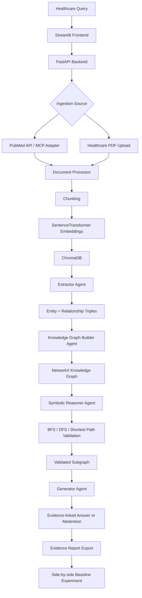

# Architecture Diagram

## Evidence Path Gate (Prototype)

The prototype applies an evidence path gate:

1. Retrieval is used only to find candidate biomedical text.
2. Candidate text is transformed into explicit triples.
3. The knowledge graph stores entities, relationships, source IDs, evidence snippets, and a coarse polarity label.
4. Traversal excludes edges labeled negative or uncertain and requires source-backed positive edges.
5. The generator receives selected graph paths and is asked to cite each factual sentence.
6. If no eligible path exists, the answer abstains.

These checks do not establish that extracted relations are correct, that a multi-hop inference is scientifically valid, or that generated prose is entailed by its citations. The application is a research prototype and must not be presented as clinical decision support. Contradictory evidence handling is limited to same-pair, same-predicate polarity conflicts detected by the reasoner.

## Multi-Agent Roles

- **Extractor Agent:** extracts biomedical entities and triples from chunks with spaCy, rules, and optional Ollama assistance.
- **Knowledge Graph Builder Agent:** creates and updates the NetworkX graph.
- **Symbolic Reasoner Agent:** performs BFS, DFS, shortest-path, and evidence validation.
- **Generator Agent:** converts validated graph paths into a cautious healthcare response.
- **Evaluation Agent:** reports structural counts and token overlap as explicitly labeled proxies. It does not measure claim support/correctness.
- **Experiment endpoint:** compares LLM-only, conventional RAG, unvalidated GraphRAG, and deterministic-path GraphRAG with the same retrieved chunks per question and selected model. It records latency and source IDs; human review is required for correctness claims.
